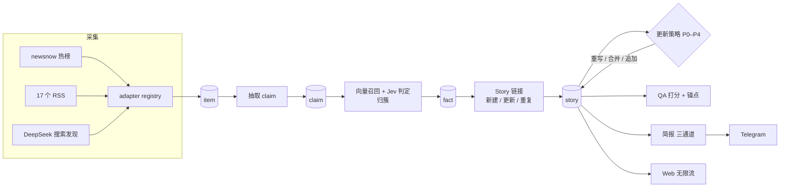
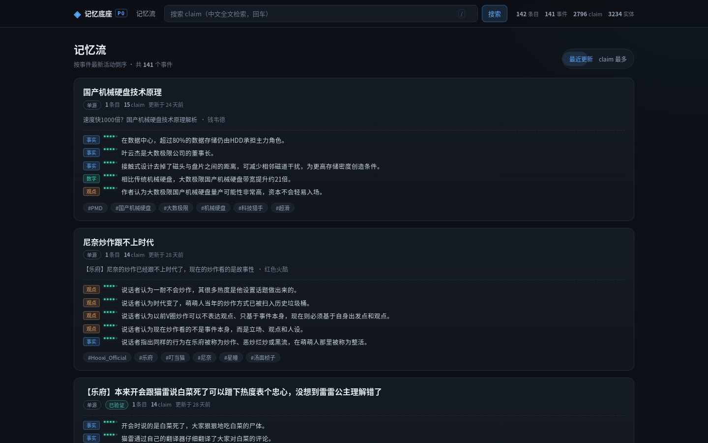
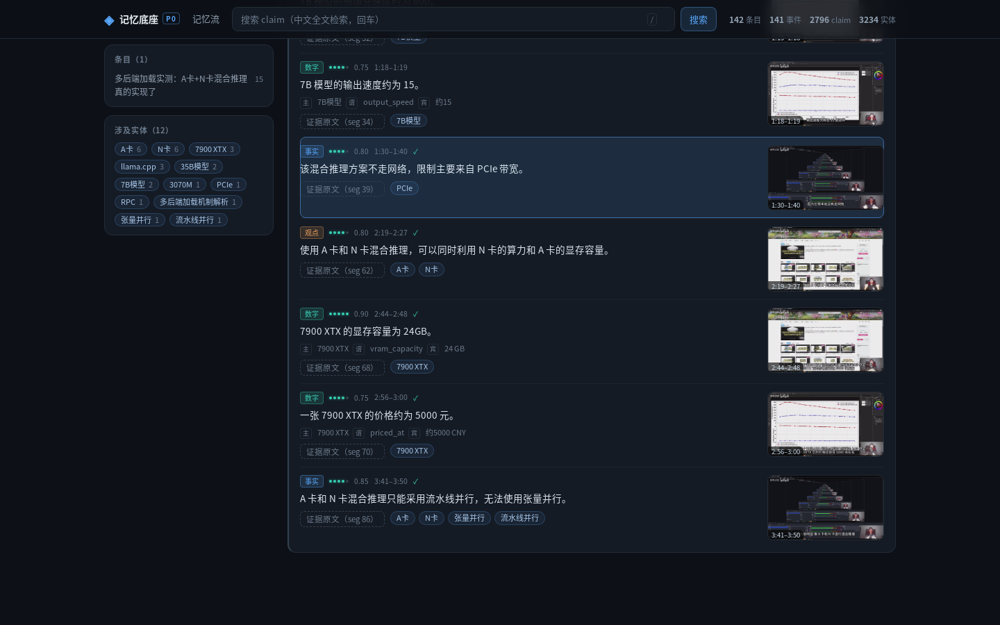
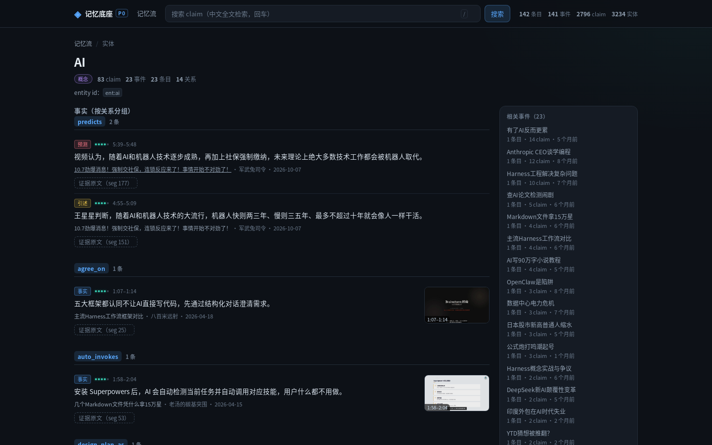
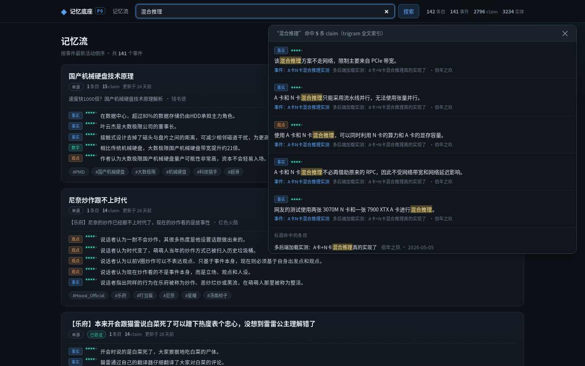

# Winnow

**把新闻洪流折叠成可读的 Story 的个人记忆系统。**

> *winnow*：扬场——把谷子抛起来，让风吹走谷壳，留下能吃的部分。

*Personal memory & information filter — turn an endless feed into a handful of stories you can actually read, and remember what you decided to keep.*

[](LICENSE)
[](package.json)
[](tests/)

---

## 这是什么

每天有几百条新闻在重复同一件事：一家公司发布同一条消息，十个媒体写十遍。多数阅读器只是在**堆积**——堆到最后你一条都不想看。

winnow 做三件不同的事：

1. **折叠**：把同一事件的多条报道合成一篇连贯的 Story，只在"真的发生了新事"时才更新它；
2. **记住**：你说"记住这个"，它就记住；你标"已追平"，它就不再拿旧账搔你；
3. **筛选**：每天只给你几条——必看 / 兴趣 / 探索，附一句"为什么推给你"。

阅读单位是 **Story**，不是条目。记忆单位是 **Fact**，不是原文。原始报道不丢，作为证据挂在每条事实下面。

```
来源 → Item（原文） → Claim（原子断言 + 证据定位） → Fact（去重后的记忆单元） → Story（可读的成稿）
```

| 层 | 是什么 | 作用 |
|---|---|---|
| **Item** | 一篇抓到的文章 / 帖子 | 证据原文，永不修改 |
| **Claim** | 从原文抽出的原子断言（主语-谓语-宾语 + 时间 + 引文） | 可检索、可证伪的最小单位 |
| **Fact** | 语义相同的 Claim 归簇后的记忆单元 | 冗余的 7 篇报道 = 1 条 Fact + 7 份支持 |
| **Story** | 由一组 Fact 写成的连贯正文（带 section 锚点） | 你真正读的东西，也是唯一有"版本"的东西 |

> 设计取舍：Story 是**交付物**，Fact 是**记忆索引**，Claim 是**证据**。三者不互相冒充——这也是这套系统能长期不烂掉的原因。见 [docs/adr](docs/adr/)。

## 为什么不用现成的

| 现成方案 | 它擅长 | 它不做 |
|---|---|---|
| RSS 阅读器 | 按源堆积 | 跨源折叠、事件级更新、记忆 |
| Read-later / 笔记 | 收藏与手写 | 自动抽取事实、跟踪演进 |
| 新闻摘要 App | 单篇摘要 | 记住你读过什么、你要什么 |
| AI 聚合流 | 生成内容 | 证据可回溯、可纠错、可不看 |

winnow 的前提是：**你的注意力有限，而同一件事只需要读一次**。

## 架构



四层依赖，单向向下，没有环：

```
src/web  ─┐
src/cli  ─┼─→ src/domains/*  ─→ src/providers/*  ─→ src/shared
```

- `src/shared` — 配置、数据库、schema、并发池。**不认识任何业务概念。**
- `src/providers` — LLM / embedding / Jev / 搜索 / Telegram 的薄封装，全部可用环境变量替换。
- `src/domains` — 业务域：`ingest`（采集）、`knowledge`（事实与链接）、`story`（成稿与更新）、`memory`（你的标注）、`insights`（覆盖地图）、`delivery`（简报）、`ops`（度量）。
- `src/cli` / `src/web` — 只做编排与展示，不含业务规则。

细节见 [docs/architecture.md](docs/architecture.md)。

## 界面

| 无限流 | Story 详情 |
|---|---|
|  |  |

| 实体 | 搜索 |
|---|---|
|  |  |

十一页：`/` 无限流 · `/story/:id` 详情（事实锚点 + 证据 + 时间线） · `/entity/:id` · `/topics` 覆盖地图 · `/search` · `/claims` 数据质量 · `/brief` 简报 · `/memory` 我要记住的 · `/audit` 审计。

## 快速开始

**要求**：Node ≥ 22.5（用 `node:sqlite`）、一个 OpenAI 兼容的 chat 端点、一个 embedding 端点。

```bash
git clone <this-repo> winnow
cd winnow
npm install

cp .env.example .env      # 填入 key（也可以放 .secrets/，见下）
npm run db:init           # 建空库（schema 在代码里，幂等）
npm run health            # 检查 db / embed / jev / telegram

# 采集一批并成稿
npm run pipeline -- --adapter=rss --limit=20

# 起 Web（默认 3083）
npm run web
```

打开 `http://127.0.0.1:3083/`。

### 从零到第一篇 Story

```bash
# 1) 只抓一篇，看链路
npm run pipeline -- --urls=https://example.com/article

# 2) 看抽出了什么事实
node src/cli/link-audit.mjs            # 链接判定报告
node src/domains/story/qa.mjs          # QA 打分

# 3) 生成今天的简报（不发送）
npm run brief -- --out

# 4) 发到 Telegram（需要 TELEGRAM_*）
npm run brief -- --send
```

## 常用命令

| 命令 | 作用 |
|---|---|
| `npm run pipeline -- --adapter=rss --limit=20` | 采集 → 抽取 → 归簇 → 链接 → 成稿/更新 → QA |
| `npm run pipeline -- --search --hot=3` | 搜索发现 + 热榜补充候选，再入库 |
| `npm run collect -- --adapter=hn --limit=10` | 只采集，不入库（调试 adapter 用） |
| `npm run brief -- --out --send` | 生成并推送每日简报 |
| `npm run daemon -- --once` | 一次性跑 pipeline → brief → metrics |
| `npm run health` | 依赖健康检查 |
| `npm run db:stats` / `db:backup` | 库概览 / 一致性快照 |
| `npm test` | 单元 + 集成测试（无需真实 key） |

全部 CLI 都支持 `--help` 风格的自述注释（见各文件头部），并在 `package.json` 里给出了主入口。

## 配置与密钥

**代码里没有硬编码的 key、路径或主机名。** 全部走 `src/shared/config.mjs`：

- 环境变量优先；根目录 `.env` 会被自动加载（不覆盖已存在的 env）；
- 密钥可直接放 env，也可放 `.secrets/<name>`（已在 `.gitignore`）；
- 数据源清单在 `config/feeds.json`，搜索主题在 `config/search_queries.txt`——**改源不用改代码**。

```bash
# 最小可用
OPENCODE_GO_API_KEY=...        # chat：抽取 / 成稿 / 简报文案
OPENROUTER_API_KEY=...         # embedding：baai/bge-m3（1024 维）
ZEN_API_KEY=...                # Jev 判定（有免费通道，失败自动兜底）
```

完整清单见 [`.env.example`](.env.example) 与 [docs/operations.md](docs/operations.md)。

## 项目状态

早期但可用：本人每日在用（462 篇 Story / 7,460 条 claim → 6,929 条 fact / 139 个源，QA 均分 80.6）。

- ✅ 采集（RSS / 热榜 / 搜索发现，正文抓取 + 兜底）
- ✅ 抽取、事实归簇、Story 链接与去重
- ✅ 基于语义的更新策略（P0 撤回 → P4 无动作）、节合并、版本快照回滚
- ✅ QA 打分、锚点校验、证据可定位率 99.9%
- ✅ 个人层：记忆捕获、追平状态、标注、立场、深研
- ✅ 简报三通道 + Telegram 推送 + Web 九页
- ⏳ 标题层词组闸门、热度加权进简报、B 站视频源、外网镜像

路线与已知缺口见 [docs/design/STATUS.md](docs/design/STATUS.md)。

## 文档

| 文档 | 内容 |
|---|---|
| [docs/architecture.md](docs/architecture.md) | 分层、模块职责、依赖规则 |
| [docs/data-model.md](docs/data-model.md) | 表结构与不变量 |
| [docs/pipeline.md](docs/pipeline.md) | 采集 → 成稿全流程与门禁 |
| [docs/memory.md](docs/memory.md) | 记忆捕获、追平、标注、立场 |
| [docs/briefing.md](docs/briefing.md) | 简报候选、评分与三通道 |
| [docs/web.md](docs/web.md) | 路由、查询层、如何加一页 |
| [docs/operations.md](docs/operations.md) | 部署、备份、排错 |
| [docs/development.md](docs/development.md) | 开发规范、加一个 adapter |
| [docs/adr/](docs/adr/) | 架构决策记录 |
| [docs/design/](docs/design/) | 设计推演与历史报告 |

## 参与

欢迎 issue / PR。改代码前先读 [CONTRIBUTING.md](CONTRIBUTING.md)；它是单人项目，没有行为准则委员会，**默认假设来者善意**。

## License

MIT © winnow contributors
