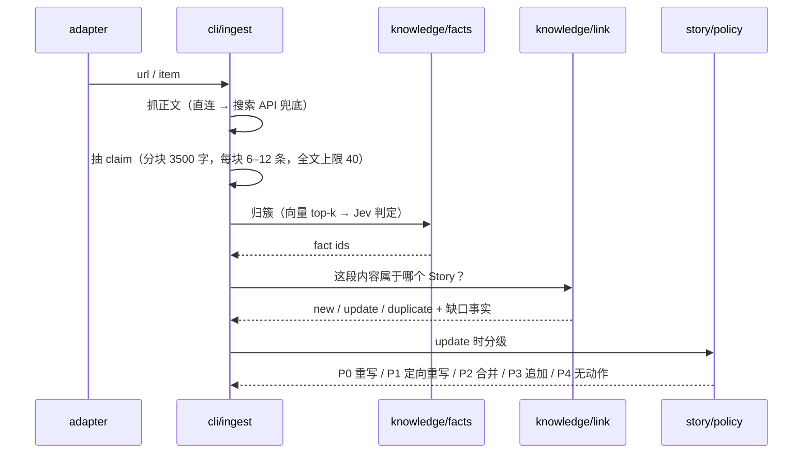
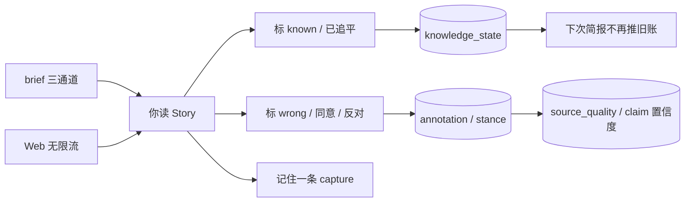

# 架构

## 设计目标

1. **一个阅读单位**：Story。所有采集、抽取、去重、更新都为它服务。
2. **可验证**：每条事实都能回到原文的具体位置（`claim` 上的 span 与 excerpt）。
3. **可演进**：换模型、换源、换部署形态都不应改动业务规则。
4. **可离线**：除 provider 外没有外部依赖；数据库是一个文件。

## 分层

```
┌─────────────────────────────────────────────┐
│  src/web   只读 SSR + 极少写入（capture/标注）│  展示层
│  src/cli   命令编排，不含业务规则             │
├─────────────────────────────────────────────┤
│  src/domains                                │  业务域
│   ingest   knowledge   story   memory       │
│   insights  delivery   ops                  │
├─────────────────────────────────────────────┤
│  src/providers  llm embed jev search telegram│  外部能力
├─────────────────────────────────────────────┤
│  src/shared     config db schema pool        │  基础设施
└─────────────────────────────────────────────┘
```

**依赖规则（单向）**：

- `shared` 不 import 任何上层模块；
- `providers` 只 import `shared`；
- `domains` 可 import `shared` 与 `providers`，域之间**只允许通过显式函数调用**，不共享可变状态；
- `cli` / `web` 可 import 任意下层，反向禁止。

`npm run check` 与 CI 会跑语法检查；域间越权 import 目前靠 review 把关（计划加一条静态检查，见 `docs/development.md`）。

## 模块地图

### shared —— 基础设施

| 模块 | 职责 |
|---|---|
| `config.mjs` | **唯一**的路径 / 环境变量 / 密钥入口。`.env` 自动加载，不覆盖已有 env |
| `db.mjs` | `openDb()` / `freshDb()`（WAL、busy_timeout；外键约束未启用，见 data-model），以及文本小工具 |
| `net.mjs` | 出站抓取护栏：只允许公网 http(s)、逐跳校验重定向、响应体上限（防 SSRF） |
| `schema.mjs` | 数据库 schema 的**唯一权威定义**（v17，50 表 + 索引，全部 `IF NOT EXISTS`；`openDb()` 打开即补列） |
| `pool.mjs` | 全局并发池：限流 + 429 感知（默认 10 并发） |

### providers —— 外部能力

| 模块 | 职责 | 可替换性 |
|---|---|---|
| `llm.mjs` | OpenAI 兼容 chat，重试 / 退避 / 用量记账 | `OPENCODE_GO_API_KEY`、`WINNOW_CREDENTIALS_FILE` |
| `embed.mjs` | 向量化，1024 维 | `EMBED_PROVIDER=openrouter\|local`，失败自动兜底 |
| `jev.mjs` | 「是否同一事件 / 同一事实」判定（返回 0–1） | Zen 免费通道优先，OpenRouter 兜底 |
| `search.mjs` | 搜索发现 + 正文抓取兜底 | `DEEPSEEK_SEARCH_TOKEN`，5 QPS 限速 |
| `telegram.mjs` | IM 推送（3500 字分片；默认纯文本，HTML 模式需调用方 `escapeHtml`） | `TELEGRAM_BOT_TOKEN` / `TELEGRAM_CHAT_ID` |

所有 provider 都**惰性取密钥**：模块可以被 import 而不触发凭据读取，测试环境无需真 key。

### domains —— 业务域

| 域 | 模块 | 职责 |
|---|---|---|
| **ingest** | `adapters/{rss,hn,newsnow}.mjs` | 源适配器，统一契约 `list / fetch / normalize / health` |
| | `registry.mjs` | 注册表 + `collect()`（自动建 `source` 行、健康记录） |
| | `feed.mjs` | 零依赖 RSS/Atom 解析、HTML→blocks、引文定位 |
| | `html.mjs` | 线性时间的元素扫描（替代会退化成 O(n²) 的正则） |
| | `extract.mjs` / `page.mjs` | 正文抽取；直连失败时用搜索 API 的 fetch 兜底（内网地址不外发） |
| | `store.mjs` | 条目抓取与入库（`item` upsert + `item_block`） |
| | `queue.mjs` | 待入库队列（入队闸门、原子领取、卡死回收） |
| **knowledge** | `facts.mjs` | claim → fact 归簇（向量召回 + Jev） |
| | `link.mjs` | 新内容 → 已有 Story 的链接与事实缺口分析 |
| | `align.mjs` | 句子 ↔ 事实的锚点对齐与修复 |
| | `evidence.mjs` | 证据门禁：引文必须能在原文中定位 |
| | `alias.mjs` | 主题别名（英伟达 ↔ NVIDIA），供跨语言检索 |
| **story** | `policy.mjs` | 更新分级 P0–P4 + 是否节合并 |
| | `rewrite.mjs` | 全量重写（快照 → 生成 → QA 门禁 → 可回滚） |
| | `rewrite-targeted.mjs` | 定向重写：只重写受影响的小节 |
| | `rewrite-small.mjs` | 短 Story 整篇重生成 |
| | `consolidate.mjs` | 节合并：多个「最新进展」合成一节 |
| | `store.mjs` | `sectionId()` 唯一格式、`upsertStory()`、历史章节 id 修复 |
| **memory** | `state.mjs` | 知识水位（看过 / 已知 / 已追平）+ capture |
| | `annotation.mjs` | 标注闭环：known / wrong / agree / disagree / read |
| | `depth.mjs` | 三轴下探：时间线 / 证据 / L4 深研（按需生成并缓存） |
| **insights** | `beat.mjs` | 覆盖地图：主题缺口、只知标题、漏掉的文章、建议动作 |
| **delivery** | `brief.mjs` | 简报候选 → 评分 → 三通道 → 文案 |
| **ops** | `metrics.mjs` | 追平率 / 冗余率 / QA 均分 / 简报选择率 |
| | `source-quality.mjs` | 源质量：验证率 / 争议率 / 纠错率 |

### cli —— 命令

每个文件是一个可独立运行的小程序，头注释即用法说明。核心几个：

| 命令 | 作用 |
|---|---|
| `cli/pipeline.mjs` | 一键流水线（采集 → 入库 → 更新 → 合并 → QA → 日报），依次调用下面几个 |
| `cli/ingest.mjs` | 入库主流程：抓取 → 抽 claim → 归簇 → 链接判定 → 新建/更新 |
| `cli/finalize.mjs` | 为判定为 `new` 的条目建档、生成首版正文 |
| `cli/apply-policy.mjs` / `cli/apply-consolidate.mjs` | 批量执行更新分级 / 节合并（Jev 不可用时跳过，留待下次） |
| `cli/qa.mjs` | QA 打分 v3（7 个维度 + 惩罚项） |
| `cli/realign.mjs` | 批量锚点重对齐 |
| `cli/policy-regression.mjs` | 用真实更新回放策略，只判定不执行 |
| `cli/worker.mjs` | 消费入库队列 |
| `cli/collect.mjs` | 只采集 |
| `cli/brief.mjs` | 生成 / 推送简报 |
| `cli/daemon.mjs` | 每日调度（`--once` / `--loop --at=08:00`） |
| `cli/health.mjs` / `cli/drill.mjs` | 健康检查 / 降级演练 |
| `cli/capture.mjs` / `cli/im-capture.mjs` | 记忆捕获（CLI / Telegram） |
| `cli/db.mjs` | 初始化 / 统计 / 备份 / 压缩 |

### web —— 展示

| 模块 | 职责 |
|---|---|
| `server.mjs` | 零依赖 HTTP 服务、路由、SSR 渲染、静态资源 |
| `queries.mjs` | 只读查询层的 barrel |
| `queries/{pages,story,search,item}.mjs` | 按页面域拆分的查询 |
| `db.mjs` / `shared.mjs` | 只读连接、SQL 辅助、展示字段装饰 |
| `views/{fmt,templates}.mjs` | 纯函数格式化 + HTML 片段 |
| `write.mjs` | 唯一的写入路径（capture / knowledge_state / annotation） |
| `public/` | `app.js`（交互）、`style.css`、四个 HTML 骨架 |

## 两条主流程

### 1. 新内容入库



判定结果写进 `ingest_decision`，可回放、可审计。

### 2. 一次阅读



## 关键不变量

1. **证据红线**：没有可定位引文的 claim 标 `unverified`，不进入 Story 的骨架。
2. **正文可回滚**：每次重写前写 `story_version` 快照，QA 不过就回滚。
3. **重写要过门禁**：覆盖率、长度、重复率、受影响小节数四条线，任何一条不过就降级为追加。
4. **Story 不静默消失**：重复 / 并入用 `story_kind` + `merged_into` 表达，链接永远可追。
5. **标注是元数据**：你的标注不写进正文，只影响后续选择与置信度。

## 为什么这样拆

| 决策 | 原因 | 代价 |
|---|---|---|
| Story 而非 claim 作为阅读单位 | claim 流不可读；人读的是事件 | 需要重写与门禁，复杂度高 |
| Fact 作为记忆单位 | 冗余 7→1，支持"这条事实有 7 家报道" | 需要归簇与判定成本 |
| 只在语义需要时重写 | 每次更新都重写会丢信息、烧钱 | 需要 P0–P4 分级，规则多 |
| SQLite 单文件 | 零运维、可备份、可离线 | 单写者；并发靠队列与锁 |
| SSR 无前端框架 | 页面简单、加载快、可 grep | 交互要手写少量 JS |

更多取舍记录见 [adr/](adr/)。
